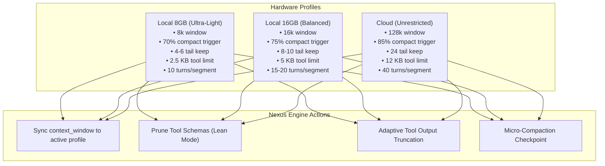

# Local Models Guide: Maximum Output on 8GB & 16GB MacBooks

This guide details how local models can be integrated into Nexus (Maverick) so that users with **8GB and 16GB Apple Silicon MacBooks (M1/M2/M3/M4) or consumer laptops** get a responsive, reliable agentic automation experience—mirroring cloud performance without memory thrashing, system freezes, or context overflow crashes.

---

## 1. Hardware Reality: 8GB vs 16GB Unified Memory

Apple Silicon uses **Unified Memory Architecture (UMA)**, meaning RAM is shared between the macOS operating system, desktop applications, GPU, and the LLM's weights and KV cache.

### Memory Breakdown

```
┌─────────────────────────────────────────────────────────────┐
│ 8GB Unified Memory MacBook                                  │
├──────────────────────┬──────────────────────┬───────────────┤
│ macOS + UI + Apps    │ Model Weights (Q4)   │ KV Cache + OS │
│ (~2.8 GB - 3.2 GB)   │ (~1.8 GB - 2.2 GB)   │ (~2.6 GB free)│
└──────────────────────┴──────────────────────┴───────────────┘

┌─────────────────────────────────────────────────────────────┐
│ 16GB Unified Memory MacBook                                 │
├──────────────────────┬──────────────────────┬───────────────┤
│ macOS + UI + Apps    │ Model Weights (Q4)   │ KV Cache + OS │
│ (~3.5 GB)            │ (~4.5 GB - 5.0 GB)   │ (~7.5 GB free)│
└──────────────────────┴──────────────────────┴───────────────┘
```

### Why 7B+ Models Struggle on 8GB MacBooks
1. A 7B parameter model quantized to `Q4_K_M` requires **~4.7 GB** of VRAM just to store weights.
2. An 8K context KV cache at FP16 requires another **~1.0 GB – 1.5 GB**.
3. Total memory needed: $3.0\text{ GB (OS)} + 4.7\text{ GB (Weights)} + 1.2\text{ GB (KV)} = \mathbf{8.9\text{ GB}}$.
4. **Result on 8GB Mac**: Memory pressure goes critical, macOS starts heavy disk swapping to the SSD, the machine stutters, and the agent loop slows to < 2 tokens/second.

### Recommended Model Tiers

| Hardware | Best Models | Size (Q4) | Target Context (`num_ctx`) | Tokens/sec (M-series) |
| :--- | :--- | :--- | :--- | :--- |
| **8GB MacBooks** | `qwen2.5-coder:3b`<br>`qwen2.5-coder:1.5b`<br>`llama3.2:3b` | 1.2 GB – 2.0 GB | **8,192** (or 4,096) | 35 – 65 t/s |
| **16GB MacBooks** | `qwen2.5-coder:7b`<br>`llama3.1:8b`<br>`qwen2.5-coder:14b` (Q3_K_M) | 4.5 GB – 8.5 GB | **16,384** (or 32,768) | 22 – 40 t/s |
| **Cloud / 32GB+** | Grok-4, Claude 3.5 Sonnet, GPT-4o | N/A | **128,000 – 200,000** | Cloud rate |

> **Key Takeaway**: `qwen2.5-coder:3b` is exceptionally capable at terminal commands, file edits, and JSON tool calling while fitting effortlessly into 2 GB of RAM. For 16GB machines, `qwen2.5-coder:7b` provides near-GPT-4o mini code reasoning.

---

## 2. Why Cloud Defaults Break Local Models

Nexus was originally sliced from the xAI Grok CLI, which was built for cloud models with 128k–200k context windows. Right now, running a local model encounters four specific friction points:

1. **The 128,000-Token Blind Spot**:
   - `OpenAiProvider` and `SamplingConfig` hardcode `context_window = 128_000`.
   - Compaction only triggers at **85% of 128,000 = 108,800 tokens**.
   - If your local model runs with an 8k context, it crashes at token 8,193 with `400 Bad Request: context length exceeded`. Nexus never attempts to compact because it is waiting for 108k tokens.
2. **Tool Schema Overhead**:
   - Nexus injects verbose JSON schemas for 8 core tools (`run_terminal_cmd`, `read_file`, `write_to_file`, `search_replace`, `list_dir`, `grep`, `todo_write`, `duckduckgo_search`) plus MCP tools on every turn.
   - This burns **1,500 – 2,500 tokens** before any user prompt or history is added.
   - On an 8k model, 30% of the entire window is lost on turn 1.
3. **12 KB Tool Outputs**:
   - Default output truncation is 12,000 bytes (~3,000 tokens).
   - A single file read or terminal output can consume 40% of an 8k local context.
4. **24-Message Kept Tail**:
   - Compaction currently keeps the newest 24 items verbatim.
   - 24 turns of tool calls and outputs easily exceed 8k–16k tokens by themselves.

---

## 3. The Optimization Blueprint

To make local models feel like cloud models on 8GB and 16GB machines, Nexus needs three hardware-tuned profiles:



### Profile Specification Table

| Setting | Local 8GB ("Ultra-Light") | Local 16GB ("Balanced") | Cloud (Default) |
| :--- | :--- | :--- | :--- |
| **`context_window`** | `8_192` | `16_384` | `128_000` |
| **`compaction_threshold`** | `70%` (~5,734 tokens) | `75%` (~12,288 tokens) | `85%` (108,800 tokens) |
| **`tail_keep_items`** | `4 – 6` | `8 – 10` | `24` |
| **`max_tool_output_bytes`** | `2,500` bytes (~625 tokens) | `5,000` bytes (~1,250 tokens) | `12,000` bytes (~3,000 tokens) |
| **`max_turns` per segment** | `10` | `15 – 20` | `40` |
| **Tool Spec Mode** | Lean (concise descriptions) | Lean / Standard | Full Schema |

---

## 4. How to Use Local Models with Nexus Today

You can run local models right now using **Ollama** or **LM Studio** through Nexus's custom provider support:

### Step 1: Set up Ollama with Sufficient Context

By default, Ollama initializes models with `num_ctx = 2048`, which is too small for agentic tool use. You should set `num_ctx 8192` (for 8GB) or `16384` (for 16GB).

Create a Modelfile:
```dockerfile
FROM qwen2.5-coder:7b
PARAMETER num_ctx 16384
```
Build it:
```bash
ollama create qwen-coder-16k -f Modelfile
```
Or run directly:
```bash
# For 8GB Mac:
ollama run qwen2.5-coder:3b

# For 16GB Mac:
ollama run qwen2.5-coder:7b
```

### Step 2: Connect Nexus to Ollama
1. Open Nexus **Settings** (`Cmd+,` or click Settings in the sidebar).
2. Go to the **Providers** tab.
3. Under **Custom Providers**, configure:
   - **ID**: `ollama`
   - **Base URL**: `http://localhost:11434/v1`
   - **Model**: `qwen2.5-coder:7b` (or `qwen2.5-coder:3b`)
   - **Kind**: `OpenAI`
4. In the **Context** tab of Settings:
   - Set **Compact at**: `70%`
   - Set **Keep newest messages**: `6`
   - Set tool output budgets if needed.

---

## 5. Architectural Implementation Blueprint

When you are ready to code this into Nexus, here are the exact components and files to modify:

### 1. `nexus/src-tauri/src/config.rs`
- Add `HardwareProfile` enum (`Local8gb`, `Local16gb`, `Cloud`).
- Add `hardware_profile: Option<HardwareProfile>` and `context_window: Option<u64>` to `ProviderSettings`.
- Helper `effective_context_window(&self) -> u64`:
  ```rust
  impl ProviderSettings {
      pub fn effective_context_window(&self) -> u64 {
          self.context_window
              .or_else(|| self.hardware_profile.map(|p| p.default_context_window()))
              .unwrap_or(128_000)
      }
  }
  ```

### 2. `nexus/src-tauri/src/providers/openai.rs`
- Add `context_window: u64` field to `OpenAiProvider`.
- Update `with_context_window(api_key, base_url, model, context_window: Option<u64>)`.
- Return `self.context_window` in `Provider::context_window(&self)`.

### 3. `nexus/src-tauri/src/providers/mod.rs`
- Add `is_local_endpoint(id, base_url)`.
- If `base_url` points to `localhost:11434` (Ollama) or `localhost:1234` (LM Studio), default the fallback context window to `8_192` instead of `128_000`.

### 4. `nexus/src-tauri/src/compaction.rs`
- Enhance `CompactPolicy::with_window`:
  ```rust
  pub fn with_window(mut self, window: u64) -> Self {
      let win = window.max(1);
      self.context_window = win;
      if win <= 8_192 {
          self.tail_keep_items = self.tail_keep_items.min(6);
          self.threshold_percent = self.threshold_percent.min(70);
      } else if win <= 16_384 {
          self.tail_keep_items = self.tail_keep_items.min(10);
          self.threshold_percent = self.threshold_percent.min(75);
      }
      self
  }
  ```

### 5. `nexus/src-tauri/src/agent_loop.rs`
- Scale default tool output limit based on `effective_context_window`:
  - $\le 8,192$: `2,500` bytes (~600 tokens)
  - $\le 16,384$: `5,000` bytes (~1,250 tokens)
  - Otherwise: `12,000` bytes

### 6. `nexus/src-tauri/src/commands.rs`
- Add `detect_local_engines` command: probes `http://127.0.0.1:11434/api/tags` and `http://127.0.0.1:1234/v1/models` to discover installed models and auto-populate settings.

### 7. `nexus/frontend/src/components/Settings.tsx`
- Add "Detect Local Engines" button and a hardware profile selector (`Local 8GB`, `Local 16GB`, `Cloud`).

---

## 6. Supercharging Local Models: TurboQuant & KV Cache Compression

### What is TurboQuant?
**TurboQuant** is a key-value (KV) cache compression breakthrough developed by Google Research (ICLR 2026). It shrinks the memory footprint of the attention KV cache down to **3–4 bits per element** (a **4x to 6x reduction in VRAM**) with near-zero accuracy loss.

It uses a two-stage mathematical pipeline:
1. **PolarQuant**: Rotates KV vectors via randomized orthogonal Hadamard transforms into a uniform geometric space, eliminating attention outliers.
2. **QJL Error Correction**: Uses a 1-bit Quantized Johnson-Lindenstrauss projection to cancel residual quantization error, preserving exact attention retrieval.

### Memory Comparison: Standard FP16 vs. TurboQuant (3.5-bit)

| Model | Context Size | Standard FP16 KV Cache | TurboQuant KV Cache | VRAM Saved |
| :--- | :--- | :--- | :--- | :--- |
| **Qwen 2.5 Coder 3B** | 8,192 tokens | ~600 MB | **~150 MB** | 75% |
| **Qwen 2.5 Coder 3B** | 32,768 tokens | ~2.4 GB | **~600 MB** | **1.8 GB** |
| **Qwen 2.5 Coder 7B** | 8,192 tokens | ~1.2 GB | **~300 MB** | 75% |
| **Qwen 2.5 Coder 7B** | 32,768 tokens | ~4.8 GB | **~1.2 GB** | **3.6 GB** |
| **Qwen 2.5 Coder 14B** | 32,768 tokens | ~6.5 GB | **~1.6 GB** | **4.9 GB** |

### Why This is a Game-Changer for 8GB & 16GB MacBooks

1. **8GB MacBooks can run 32K context**:
   - Model weights (`qwen2.5-coder:3b` Q4): **~2.0 GB**
   - TurboQuant 32K KV cache: **~0.6 GB**
   - macOS + Nexus: **~3.0 GB**
   - **Total memory used**: **~5.6 GB out of 8 GB**.
   - *Result*: You get a full 32K context window on an entry-level 8GB MacBook Air without disk swapping or stuttering!
2. **16GB MacBooks can run 7B or 14B models with 32K context**:
   - Model weights (`qwen2.5-coder:7b` Q4): **~4.7 GB**
   - TurboQuant 32K KV cache: **~1.2 GB**
   - macOS + Nexus: **~3.5 GB**
   - **Total memory used**: **~9.4 GB out of 16 GB**.
   - *Result*: 6.6 GB of unified memory remains completely free for your code editor, terminal, and browser!

### How to Enable Quantized KV Caches Today

TurboQuant and quantized KV caches operate inside the **local inference engine** (Ollama, llama.cpp, vLLM), not inside the Nexus client:

#### 1. In Ollama
Ollama supports KV cache quantization and Flash Attention via environment variables:
```bash
# Set in ~/.zshrc or launch terminal:
export OLLAMA_FLASH_ATTENTION=1
export OLLAMA_KV_CACHE_TYPE=q4_0    # 4-bit KV cache (or q8_0 for 8-bit)
ollama serve
```

#### 2. In llama.cpp / llama-server
```bash
llama-server \
  -m qwen2.5-coder-7b-instruct-q4_k_m.gguf \
  -c 32768 \
  --flash-attn \
  -ctk q4_0 \
  -ctv q4_0
```

#### 3. In vLLM (with TurboQuant plugin)
```bash
vllm serve Qwen/Qwen2.5-Coder-7B-Instruct \
  --kv-cache-dtype turboquant
```

When coupled with Nexus, you can increase the `context_window` setting in Nexus from 8,192 up to **32,768**, giving your local models the deep context memory of cloud agents while staying well within consumer RAM limits.

